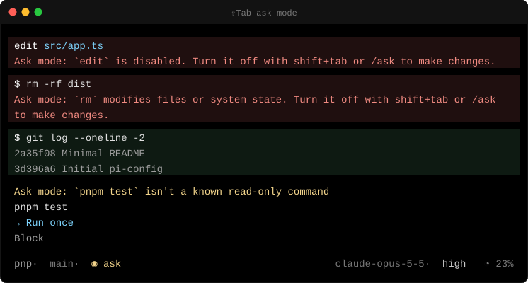
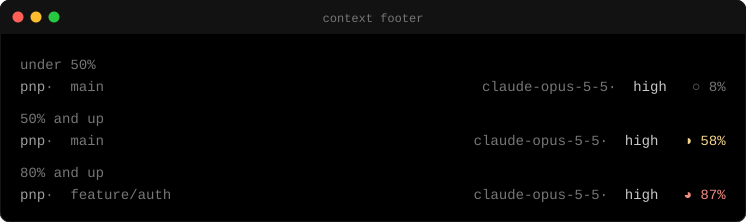
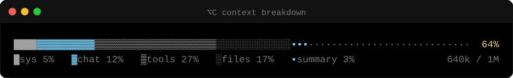

# pi-config

My [pi](https://pi.dev) setup.

```bash
curl -fsSL https://raw.githubusercontent.com/abdurmasood/pi-config/main/install.sh | bash
```

Run again to update. Your existing settings and keybindings are never overwritten.

## Ask mode · `⇧Tab`

The agent can investigate but not change anything. Risky commands ask first.



## Context footer · `⌥C`

Folder, branch, model, and how full the context is.



`⌥C` shows what's filling it.



## Also

- `⌥T` cycles thinking level (moved from `⇧Tab`)
- `black-mono` theme

`⌥` keys need *Option as Alt* enabled in your terminal.

## Develop

```bash
git clone https://github.com/abdurmasood/pi-config && cd pi-config && ./install.sh --dev
```

Edit → `./scripts/check.sh` → `/reload` → commit. `./scripts/previews.sh` regenerates the images.
